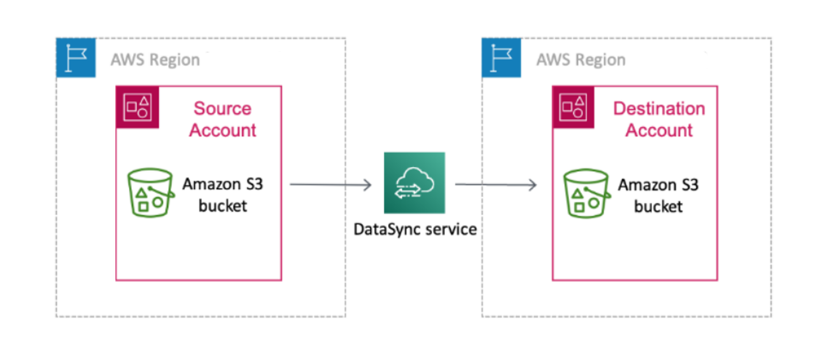

Our system is designed to accommodate the data transfer needs of our customers efficiently. Most customers prefer a daily batch export of all data, including position data and stops KPI data. To support this, we integrate with the most popular cloud providers- AWS, Google Cloud, and Azure - as well as provide a generic option via SFTP for on-premises or other cloud setups.

## AWS

For customers using AWS as their cloud provider, the setup is straightforward. Simply configure an S3 bucket with the right permission, and we will automatically update it daily with the latest data using AWS DataSync.



## Google Cloud

### How it works

truemetrics writes exports to an Amazon S3 bucket in AWS region `eu-central-1`. The bucket is owned by truemetrics and used only for your data. Each export run creates a new folder with Parquet files and a `schema.json`.

To get the files into Google Cloud, you set up a daily copy job with **Google Storage Transfer Service** (STS). The job runs in your Google Cloud project and copies new files from our S3 bucket into a Cloud Storage bucket you own.

No passwords or access keys are exchanged. truemetrics creates an AWS role that can only read your export bucket, and allows only your project's Storage Transfer Service to use it.

### Setup

#### 1. Choose a project

Pick the Google Cloud project that will run the copy job and enable the **Storage Transfer API** in it.

#### 2. Create the destination bucket

| Setting        | Recommended value                                        |
| -------------- | -------------------------------------------------------- |
| Location       | Single region in the EU, e.g. `europe-west3` (Frankfurt) |
| Storage class  | Standard                                                 |
| Access control | Uniform bucket-level access                              |
| Public access  | Prevented                                                |

If the bucket is encrypted with your own key (CMEK), or your project is inside a VPC Service Controls perimeter, see [Special cases](#special-cases).

#### 3. Send us your Storage Transfer identity

Storage Transfer Service uses a Google-managed account in your project, called the *service agent*. To find it, run [`googleServiceAccounts.get`](https://cloud.google.com/storage-transfer/docs/reference/rest/v1/googleServiceAccounts/get) with your project ID. You can use the "Try this method" panel on that page.

The response looks like this:

```json
{
  "accountEmail": "project-123456789@storage-transfer-service.iam.gserviceaccount.com",
  "subjectId": "1234567890123456789"
}
```

Send us the `subjectId`. It is not a secret. We use it to set up the AWS role so that only your service agent can use it. We then send you:

- the name of the S3 bucket
- the role ARN (`arn:aws:iam::…:role/…`)
- the time of day the export finishes

#### 4. Grant permissions

| Who | Role | On |
|---|---|---|
| The service agent (`accountEmail` from step 3) | Storage Legacy Bucket Writer (`roles/storage.legacyBucketWriter`) | The destination bucket |
| The service agent | Storage Object Viewer (`roles/storage.objectViewer`) | The destination bucket |
| The person creating the job | Storage Transfer User (`roles/storagetransfer.user`) | The project |

If you create the job in the Cloud Console with Storage Admin rights on the bucket, the console grants the two service agent roles for you.

#### 5. Create the transfer job

In the Cloud Console, go to **Storage Transfer Service → Create transfer job**:

- **Source:** Amazon S3. Enter the bucket name, and authenticate with the AWS IAM role (federated identity) using the role ARN from step 3.
- **Destination:** your bucket from step 2, optionally a folder in it.
- **Schedule:** daily, starting after the export time we sent you.
- **Options:** keep **Delete files from source** off. We keep the files on our side for our own delivery checks and clean them up ourselves.

### Special cases

- **Customer-managed encryption key (CMEK):** also grant the service agent Cloud KMS CryptoKey Encrypter/Decrypter (`roles/cloudkms.cryptoKeyEncrypterDecrypter`) on the key.
- **VPC Service Controls:** allow Storage Transfer Service in the perimeter around the destination project. Otherwise the job cannot write to the bucket.

## SFTP

For customers using other cloud providers or on-premises setups, SFTP offers a flexible solution. In this configuration, we push position data and stops KPI data to your FTP server daily. This approach ensures you always have access to the most recent data while maintaining a complete history for your reference.
