The daily export holds two kinds of data:

* **Stop KPIs**: one row per [stop](/glossary), with its durations.
* **Location data**: the parking places and entrances truemetrics learned, one row per position.

On S3 (AWS and Google Cloud) stop KPIs are Parquet files and location data are GeoParquet files.
On SFTP both are CSV by default, Parquet where agreed. Each export comes with a `schema_*.json` that
lists the columns of the files in it; where it differs from the tables below, the schema file is
right for your account. Folder and file names are in [Update and versioning](/Update_and_Versioning).

## Stop KPIs

A stop runs from parking to driving off. truemetrics detects the courier's steps during the stop
and stores them as `states` with their times in `ts`; each duration below is the time between two
of them.

<Frame caption="The durations of one stop and the columns they are in.">
  
</Frame>

Times are seconds, timestamps are Unix time in seconds (UTC). Lists are stored as text.

| Column | Type | Unit | Meaning |
|---|---|---|---|
| `id_stop` | string | | truemetrics' ID of the stop. |
| `ts_start`, `ts_end` | number | timestamp | Start and end of the stop's time window. |
| `states` | string (list) | | The detected steps, in order: `S` parked, `C` leaves the vehicle, `E` enters the building, `B` back outside, `S2` back at the vehicle, `F` drives off. Other codes can appear in between. |
| `ts` | string (list) | timestamp | The time of each entry in `states`. |
| `t_picking` | number | s | `S` to `C`: from parking to leaving the vehicle. |
| `t_outdoor_to_customer` | number | s | `C` to `E`: from the vehicle to the building entrance. |
| `t_indoor` | number | s | `E` to `B`: inside the building. |
| `t_outdoor_from_customer` | number | s | `B` to `S2`: from the building back to the vehicle. |
| `t_buffer` | number | s | `S2` to `F`: back at the vehicle until driving off, usually to prepare the next delivery. |
| `t_total` | number | s | `S` to `F`: the whole stop (stopping time), the five durations above added up. |
| `t_search` | number | s | `t_outdoor_to_customer − t_outdoor_from_customer`: how much longer the way in took than the way back, an estimate of the time spent finding the entrance; waiting at the door or carrying a heavy parcel add to it too. Empty without a detected entrance; can be negative. |
| `ts_events` | string (list) | timestamp | The times of your [metadata](/metadata) events during the stop. |
| `number_of_deliveries_in_stop` | number | count | The number of entries in `ts_events`. |
| `visits` | string (list) | | One entry per entrance walked to during the stop, for stops that serve several addresses. |
| `distance_stationary_stop`, `distance_walking_stop`, `distance_driving_stop` | number | m | Distance covered standing, walking and driving between `S` and `F`. |
| `dt_stationary_stop`, `dt_walking_stop`, `dt_driving_stop` | number | s | Time spent standing, walking and driving between `S` and `F`. |
| `id_stop_next` | string | | `id_stop` of the device's next stop. |
| `distance_next_stop` | number | m | Distance from `F` of this stop to `S` of the next. |
| `dt_next_stop` | number | s | Time from `F` of this stop to `S` of the next. |
| `ang_lat`, `ang_lon` | number | degrees (WGS 84) | Position of the stop. |
| `h3_10` | string | | [H3 cell](/glossary) of the stop at resolution 10, for spatial aggregation. |
| `extra_columns` | string (JSON) | | The extra keys of the stop's metadata, as you sent them. |
| `t_utc_created` | number | timestamp | When truemetrics computed the stop. |
| `id_api_key`, `id_phone` | string | | Your account and the device the stop was recorded on. |
| `year`, `month`, `day` | number | | UTC date of the stop. |
| `t_utc` | number | timestamp | Internal partition time. |
| *your metadata keys*, `<key>_multi` | string, string (list) | | Customer-specific: keys of your metadata in columns of their own, where agreed. |
| `timestamp_stop_beginning` | string | ISO 8601, UTC | Customer-specific: the time of `S`, in place of `ts`, `states`, `ts_start`, `ts_end` and `t_utc`. |

Some accounts get a fixed subset of these columns in a fixed order; the schema file lists them.

Without a detected entrance (no `E` in `states`), `t_indoor` is 0, the time from `C` to `S2` is
split evenly between `t_outdoor_to_customer` and `t_outdoor_from_customer`, and `t_search` is empty.

### Example row of stop KPIs

An illustrative row (not real data), shortened by the `distance_*`, `dt_*`, `visits` and partition
columns:

```json
{
  "id_stop": "72d56efe2b8cdd0f43546fa490ec80717f3bcad38980ad0a78fd1fbfd9d53f69",
  "ts_start": 1793697231.6,
  "ts_end": 1793697509.2,
  "states": "['S', 'C', 'E', 'B', 'S2', 'F']",
  "ts": "[1793697245.0, 1793697283.0, 1793697335.0, 1793697430.0, 1793697471.0, 1793697497.0]",
  "t_picking": 38.0,
  "t_outdoor_to_customer": 52.0,
  "t_indoor": 95.0,
  "t_outdoor_from_customer": 41.0,
  "t_buffer": 26.0,
  "t_total": 252.0,
  "t_search": 11.0,
  "ts_events": "[1793697392.0]",
  "number_of_deliveries_in_stop": 1,
  "ang_lat": 52.5198,
  "ang_lon": 13.4047,
  "h3_10": "8a1f1d48945ffff",
  "extra_columns": "{\"depot_id\": \"BER-3\"}",
  "t_utc_created": 1793750412.8,
  "year": 2026,
  "month": 11,
  "day": 3
}
```

## Location data

One row per parking place or entrance. Entrances and parking places come in separate files; where
agreed, a third file holds waypoints.

| Column | Type | Unit | Meaning |
|---|---|---|---|
| *merge ID*, e.g. `id_address` | string | | Your identifier of the address the position belongs to ([Address ID](/glossary)). The column is named after the merge ID agreed with you, `id_address` if none was agreed. |
| `type_position` | string | | `entrance_merged` or `parking_merged` (`waypoint_merged` in the waypoint file). Some fixed schemas leave it out; the file name tells the type. |
| `ang_lat`, `ang_lon` | number | degrees (WGS 84) | The position. `0`, `0` marks a deletion, see [Update and versioning](/Update_and_Versioning). |
| `geometry` | binary | WKB point, EPSG:4326 | The same point as `ang_lat`/`ang_lon`. GeoParquet files on S3 only. |
| `accuracy` | number | m | Estimated accuracy. For entrances it usually improves with each detection, because detections are fused. For parking places it is harder to read, as couriers don't always park in the same spot. |
| `cluster_size` | integer | count | The number of detections merged into this position. |
| `rank` | integer | | Order within the positions of one type for the same address. Only present when more than one entrance or parking place per address is agreed. |
| `h3_10` | string | | H3 cell of the position at resolution 10. |
| `id_position` | string | | truemetrics' internal ID of the position. It can change for the same address; avoid using it for filtering. |
| `t_utc_created` | number | timestamp | When the position was computed, typically a few hours after the delivery. |
| `validation_result` | string | | Customer-specific: the result of truemetrics' validation of the position. |
| `lat_reference_external`, `lon_reference_external` | number | degrees (WGS 84) | Customer-specific: your own reference coordinate for the address, for comparison. |
| `distance_reference_external` | number | m | Customer-specific: distance from the position to the nearest of your reference coordinates. |
| *address fields* | string | | Customer-specific: address fields from your metadata, such as street, house number, postcode and city. |

On SFTP, if entrances and parking places are merged on different IDs, both files carry both ID
columns, and the one that does not apply to the file is empty.

### Example row of location data

An illustrative entrance row (not real data). `geometry` is shown as WKT; the file stores it as WKB.

```json
{
  "id_address": "ADR-0418823",
  "type_position": "entrance_merged",
  "ang_lat": 52.52016,
  "ang_lon": 13.40502,
  "geometry": "POINT (13.40502 52.52016)",
  "accuracy": 4.2,
  "cluster_size": 7,
  "h3_10": "8a1f1d489447fff",
  "id_position": "a4f5d3ab275316f0a4458f1bf620862f0b98b0eab609bf92c28af3b9defadeaa",
  "t_utc_created": 1793752513.7
}
```
