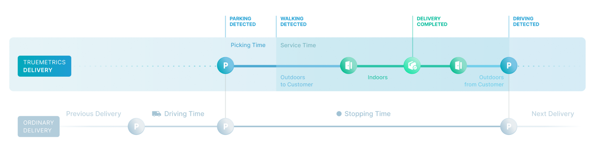
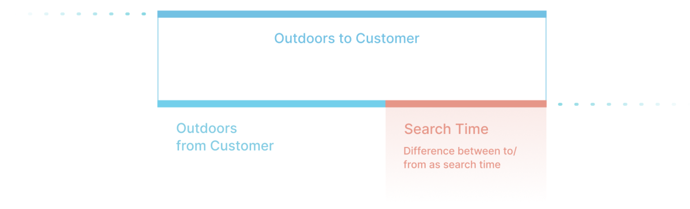

The data daily export typically includes two types of data: Stop KPI Data and Location Data.

* Stop KPI Data: Contains detailed information about each stop/delivery.
* Location Data: Includes all recorded parking places and entrances.

## Stop KPI Data

Stop KPI data is typically exported in a tabular format (parquet), with the following fields.

<ResponseField name="Delivery ID" type="STRING">
  The identifier provided by your metadata makes integrating the data into your data warehouse easier.
</ResponseField>

<ResponseField name="Stop ID" type="STRING">
  Primarily used for debugging and analysis purposes.
</ResponseField>

<ResponseField name="Timestamp Stop Beginning" type="STRING">
  ISO 8601 datetime which defines the beginning of a "stop". The beginning of a stop is defined as point of time when the courier arrive at the parking place. If you want to know the end time of the stop, add the "Stopping Time" to the timestamp.
</ResponseField>

<ResponseField name="Stopping Time" type="FLOAT (UTC seconds)">
  Total duration of the stop in seconds. This value is showing you the actual stop time of a delivery. Completely without geofences and swipe interaction of your driver, you can measure how much time was needed to perform the delivery.
</ResponseField>

<ResponseField name="H3 index" type="STRING (H3 Level 10)">
  Index to allows simple spatial aggregations to get further insights. A typical example would be that you are interested in which parts of your delivery area, exceed the average value. With the h3 index you are ready to start your spatial analyses.
</ResponseField>

<ResponseField name="Service Time" type="FLOAT (seconds)">
  Total time between leaving and returning to the vehicle.
</ResponseField>

<ResponseField name="Outdoor Service Time to Customer" type="FLOAT (seconds)">
  Duration between leaving the vehicle and entering the customer’s building.
</ResponseField>

<ResponseField name="Indoor Service Time" type="FLOAT (seconds)">
  Total duration spent inside the customer’s building to perform the delivery.
</ResponseField>

<ResponseField name="Outdoor Service Time from Customer" type="FLOAT (seconds)">
  Time between leaving the customer’s building and re-entering the vehicle.
</ResponseField>

<ResponseField name="Picking Time" type="FLOAT (seconds)">
  Duration (in seconds) from parking to leaving the vehicle to approach the delivery location.
</ResponseField>

<ResponseField name="Buffer Time" type="FLOAT (seconds)">
  Duration (in seconds) from being back at the parking to actually leaving the parking place. Normally this is used by the courier to prepare the next delivery.
</ResponseField>



<ResponseField name="Search Time" type="FLOAT (seconds)">
  Estimated time to locate the correct entrance or delivery location. This is calculated as the difference between the time from the vehicle to the entrance and back to the vehicle. This metric is an estimate and may be influenced by factors such as waiting at the door or handling a heavy delivery. Note: This duration is only available when the delivery is conducted indoors.
</ResponseField>



<ResponseField name="Custom Fields">
  truemetrics enrich your data with metadata based on the information you provide (e.g., tour ID, job type, driver, or vehicle type), enabling flexible analysis and filtering tailored to your needs.
</ResponseField>

### Example row of stop KPIs
The following example could be a typical line / row of the the parquet file.

```json
{
  "t_utc_created":1730508307.309725,
  "id_stop":"38035d61a2567dc161c039a47b286fdc61c49d75f49dceade5e010aafcbd09a0",
  "ids_delivery_external":["XXXXDHDHDH"],
  "id_driver":"YXXDDX12",
  "type_vehicle":"unknown",
  "t_picking":3.0833332538604736,
  "t_stopping":49.333333253860474,
  "t_buffer":3.0833332538604736,
  "t_indoor":0,
  "t_outdoor_from_customer":-21.583333373069763,
  "t_outdoor_to_customer":-21.583333373069763,
  "t_search":0,
  "h3_10":"8a20e60a0c67fff"
}
```

## Location Data
Location data includes recorded entrances and parking places, typically stored as GeoParquet files, with the following fields:

<ResponseField name="Address" type="STRING (multiple)">
  The Address is the the primary key, which can be either an address ID or the actual address string depending on what you send as metadata. Multiple entrances detected across deliveries are aggregated into a single, more accurate location. Multiple parking places can also be provided, depending on your visualization needs. Please discuss specific requirements with your support contact.
</ResponseField>

<ResponseField name="Position ID" type="STRING">
  Truemetrics’ internal identifier for the position. While unique, this ID may change; avoid using it for filtering.
</ResponseField>

<ResponseField name="Rank" type="INTEGER">
  This integer represents the rank of an entrance or parking place. truemetrics groups entrances and parking places based on a shared merge identifier (typically the address identifier). In some configurations, multiple entrances or parking places may be exported for the same merge identifier. The rank determines their order and priority within that group.
</ResponseField>

<ResponseField name="Position Latitude and longitude" type="FLOAT (UTC seconds)">
  Latitude and longitude coordinates of the location as float (same as geometry only different format)
</ResponseField>

<ResponseField name="Position Type" type="STRING">
  This string specifies whether the position is a parking spot or an entrance.
</ResponseField>

<ResponseField name="Timestamp" type="FLOAT (UTC seconds)">
  Timestamp in UTC seconds when the position was calculated, typically a few hours after delivery.
</ResponseField>

<ResponseField name="Accuracy" type="FLOAT (meters)">
  Estimated accuracy of the entrance or parking location. For entrances, accuracy typically improves with each detection because multiple detections are taken into account and fused to an entrance detection with higher accuracy. For parking places, accuracy is harder to interpret and can vary as drivers may not park in the same spot consistently.
</ResponseField>

<ResponseField name="Custom Fields based on your metadata">
  truemetrics enrich your data with metadata based on the information you provide (e.g., tour ID, job type, driver, or vehicle type), enabling flexible analysis and filtering tailored to your needs.
</ResponseField>

### Example row of location data
The following example could be a typical line/row of the parquet file.

```json
{
  "h3_10":"8a1f1884544ffff",
  "id_address":"f30ae15b1b5ba0e04093d841fc81a48b27e55cecdff905a3c36c94d65489921c",
  "postalcode": "test",
  "countrycode": "DE",
  "street":"teststreet",
  "street_number" : "7a",
  "lat": 4.4545,
  "lon": 23.5455,
  "type_position": "parkingplace",
  "metadata_from_customer":"test",
  "t_utc_created":1731144069.383282,
  "id_position":"6f8bded37a7b35a7f51e0fc8019462388704b2b6097c7e5636d266d54e18566a",
  "accuracy":9.648,
  "number_detections":1,
  "geometry":{"0":1,"1":1,"2":0,"3":0,"4":0,"5":14,"6":16,"7":204,"8":209,"9":227,"10":93,"11":42,"12":64,"13":214,"14":173,"15":249,"16":76,"17":209,"18":53,"19":74,"20":64}
}
```
