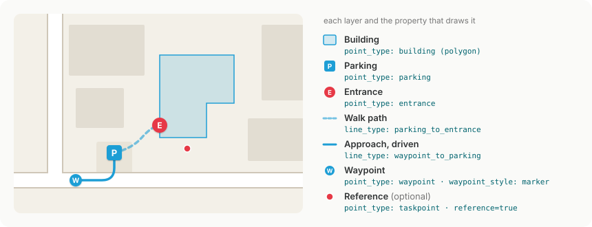
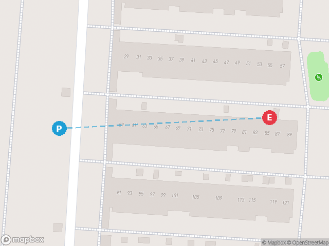

With option 1 you keep your own map and your own design, in the courier app, a dispatcher dashboard
or anywhere else. truemetrics delivers the last meter of each address as data, learned from all
deliveries to it. New deliveries count after the next nightly merge run.

| Element | Description |
| --- | --- |
| **Entrance** | The door couriers use at the address. |
| **Parking** | Where couriers park the vehicle. |
| **Waypoint** | The street point the courier is routed to, where the approach to the parking starts. The way from the waypoint to the parking is routed for driving. truemetrics learns it from the drives; your own is the `waypointLatitude` / `waypointLongitude` you can send in [metadata](/metadata). |
| **Walk path** | The way on foot from the parking to the entrance. |
| **Building** | The building footprint the entrance belongs to (when available). |

All coordinates are in **EPSG:4326** (WGS84 longitude/latitude). For how to draw them so couriers
read them at a glance, see the [best practices](/lastmeter_routing_overview#best-practices-for-the-last-meter).

There are two ways to get this data into your map.

<Frame caption="1A: through your own backend. 1B: straight from the REST API.">
  
</Frame>

## 1A · Data from your own backend

truemetrics exports parking places, entrances, waypoints and walk paths to your backend. Your
backend feeds them to the courier app, or wherever the visualisation happens, together with the
tour. The courier app never talks to truemetrics for the last meter.

<Steps>
  <Step title="truemetrics exports">
    Every day, the current last meter of all your addresses goes to your cloud storage (AWS S3,
    Google Cloud Storage) or SFTP server, keyed by the address identifier you send as metadata. See
    [Architecture of the export](/Architecture_of_Export) and the
    [location data format](/Introduction_to_data_export#location-data).
  </Step>
  <Step title="Your backend imports">
    Load the export into your own database. Join it to your addresses by the address identifier.
  </Step>
  <Step title="Your backend hands it out with the tour">
    When a tour is sent to the courier's device, add each stop's parking, entrance, waypoint and walk
    path, as you already add the address.
  </Step>
  <Step title="Your app draws it">
    Your map shows the stop with the [best practices](/lastmeter_routing_overview#best-practices-for-the-last-meter).
    Your navigation can route to the waypoint instead of the address.
  </Step>
</Steps>

**Choose 1A when** you want the data in your own systems: for planning, for other tools, for
devices with poor coverage (the tour carries everything), and with no request to truemetrics at
delivery time.

## 1B · Data from the truemetrics REST API

Your app (or your backend) asks the [Last Meter Visualisation API](/Lastmeter_API_Reference) for one
stop by its address identifiers and gets back exactly that data, ready to draw:

* a **GeoJSON `FeatureCollection`** (with `geojson=true`) you can drop straight onto a
  [MapLibre](https://maplibre.org/) or [Mapbox](https://www.mapbox.com/) map. The styling hints
  (colours, line widths, dashes) map 1:1 to map layer styles, and
* optionally a **rendered PNG image** (`raster`), so you can show a thumbnail without running a
  map renderer yourself: transparent or on a street basemap.

<Frame caption="One answer, layer by layer, with the property that draws each layer.">
  
</Frame>

**Choose 1B when** you want the latest data per stop with the least work on your side, or a picture
of the stop in an email, report, ticket or dashboard.

Typical uses:

* Plot the last meter of a stop in your own driver app or dashboard.
* Embed a small map thumbnail of a stop in an email, report or ticket.
* Show dispatchers where couriers park and which door they use at an address.

### Authentication

Every request is authenticated with your **`x-api-key`**. The key identifies your account, so you
only ever receive your own data: there is no account or customer parameter in the request. See
[API keys](/api_keys) for which key you need.

<Info>
The identifiers you pass are the same address identifiers you send to truemetrics as metadata
(your `id_address` / merge id). The entrance and parking may use **different** identifiers: pass
each to its own parameter (`identifier_entrance` / `identifier_parking`).
</Info>

Next: the [API reference](/Lastmeter_API_Reference) and [examples](/Lastmeter_Examples).

## 1A or 1B

| | 1A · own backend | 1B · REST API |
| --- | --- | --- |
| Data in your own systems | Yes, a full copy | No, fetched per stop |
| Freshness | Daily export after the nightly merge | After the nightly merge (answers cached for up to an hour) |
| At delivery time | No request to truemetrics | One request per stop |
| Rendering | Your own styling | Styling hints included, or a ready PNG |
| Work on your side | Import, storage, delivery to devices, map | Map, one HTTP call |

Both leave the routing to your own navigation. To get routing to the parking and the walk to the
door without building the map yourself, see the [truemetrics last meter module](/navigation_module).
