Every day truemetrics writes a new export. To give you control over versioning, each export is written to a new folder named after its creation time in UTC (`YYYY-MM-DD-HH-MM-SS`). Older folders stay in place. Each folder contains only the changes since the previous export, so the newest folder is not a complete data set: process every folder you have not imported yet, in timestamp order.

<Frame caption="Folders are changes: apply them oldest first.">
  
</Frame>

## When the export runs

The export starts every day at 00:01 UTC and writes the customers one after another, so your files
arrive shortly after. Each folder or file name is the UTC time it was written. An export contains:

* the stops recorded two days before, and
* the position changes of the day before.

Example: the export of 2026-11-05 contains the stops recorded on 2026-11-03 and the position changes
from 2026-11-04.

A day without changes produces no folder (on SFTP: no files). A missing day means "no changes", not
a failed export, so don't alert on it. If you expected data and nothing arrives for several days,
write to [info@truemetrics.io](mailto:info@truemetrics.io).

## Folder layout

### AWS and Google Cloud

Stop KPIs are Parquet, positions GeoParquet. A `waypoint_*.parquet` is added only where agreed.

```
s3://true-shared-YOURCOMPANY/
├── truemetrics-positions/incremental/
│   ├── 2026-11-04-00-12-26/
│   └── 2026-11-05-00-12-51/
│       ├── entrance_*.parquet
│       ├── parkingplace_*.parquet
│       └── schema_*.json
└── truemetrics-stops/incremental/
    ├── 2026-11-04-00-12-40/
    └── 2026-11-05-00-13-04/
        ├── stops_*.parquet
        └── schema_*.json
```

Every stops folder has a `schema_*.json`. A positions folder has one only if your account has a
fixed set of columns agreed with truemetrics; otherwise read the columns from the files themselves.

### SFTP

On SFTP there are no subfolders: each export puts its files straight into the folders agreed with
you, with the time in the file name. The files are CSV by default, Parquet where agreed, and always
come with a schema file. Positions files have no `geometry` column; use `ang_lat` and `ang_lon`.

```
<positions folder>/
├── 2026-11-05-00-12-51_entrances.csv
├── 2026-11-05-00-12-51_parking_places.csv
└── 2026-11-05-00-12-51_positions_schema.json
<stops folder>/                      (the positions folder, unless a separate one is agreed)
├── 2026-11-05-00-13-04_stops.csv
└── 2026-11-05-00-13-04_stops_schema.json
```

The folders must exist on your server before the first export; truemetrics does not create them.

## Incremental export for positions

truemetrics provides daily incremental exports to keep your system updated with the latest position
data. Each export holds one file for entrances and one for parking places, containing the changes
detected by truemetrics. The columns are in [Export format](/Introduction_to_data_export#location-data).

### Contents of the export

The daily files include:

* Newly detected entrances or parking places
* Updated positions, e.g., more reliable location data
* Deletions, indicated by specific markers (see below)

You can use these files to update your database by iterating over each row and applying the changes
to your data structure.

### Handling Deletions

To signal that a previously provided location should be removed, truemetrics uses coordinates with latitude = 0 and longitude = 0. This serves as an instruction to delete or invalidate the previously sent position.

Example Use Case:
If truemetrics initially sent you an entrance location that was later determined to be invalid (e.g., through manual verification), the daily export will include a row with the same identifier but with lat = 0 and lon = 0.
You should interpret this as a deletion request and the position should be either removed or ignore the from your system.

## Export for stop KPIs

Each export holds the stop KPIs of one recording day, in

`s3://true-shared-YOURCOMPANY/truemetrics-stops/incremental/{timestamp}/stops_*.parquet`

with their schema next to them in

`s3://true-shared-YOURCOMPANY/truemetrics-stops/incremental/{timestamp}/schema_*.json`

Each stop comes in the export for the day it was recorded. The columns are in
[Export format](/Introduction_to_data_export#stop-kpis).

## Importing the export

1. List the folders you have not imported yet and sort them by name. The name is the UTC time, so
   sorting by name puts the oldest first. On SFTP, do the same with the file names.

   ```bash
   aws s3 ls s3://true-shared-YOURCOMPANY/truemetrics-positions/incremental/ | awk '{print $2}' | sort
   ```

2. Take the oldest folder you have not imported and read its files.
3. For positions, go through each row. If coordinates are 0/0, delete the corresponding record by
   the identifier from your database. Otherwise, insert or update the location in your database.
4. For stops, add the rows to your stops table. Use `id_stop` to skip rows you already have.
5. Note the folder as imported and continue with the next one, until you reach the newest.

Make the import idempotent, so that processing the same folder again does no harm, for example
after a failed run.
