The truemetrics SDK records sensor data on the courier's phone and uploads it. Your app initializes
the SDK, starts and stops recording, and logs one metadata event per delivery attempt. To let a
coding agent do the integration, use the [agent prompt](/with_agent).

<Info>
  **Requirements**

  - Android 7.0 (API 24) or newer: `minSdk 24`.
  - Kotlin Gradle plugin (`org.jetbrains.kotlin.android`) 2.1 or newer. The SDK is built with Kotlin
    2.2; an older plugin fails with "Module was compiled with an incompatible version of Kotlin".
  - JVM target 11 or newer in your app module. AGP and JDK as your build needs.
  - `kotlinx-coroutines` in the app to observe the SDK status. From Java, use
    `androidx.lifecycle:lifecycle-livedata-ktx` instead.
  - An SDK API key from truemetrics, see [API keys](/api_keys).
</Info>

## Installation

Add the truemetrics Maven repository, in `settings.gradle(.kts)` under
`dependencyResolutionManagement`, or in the root `build.gradle(.kts)` under `allprojects`:

<CodeGroup>

```kotlin settings.gradle.kts
dependencyResolutionManagement {
    repositories {
        google()
        mavenCentral()
        maven { url = uri("https://github.com/TRUE-Metrics-io/truemetrics_android_SDK_p_maven/raw/main") }
    }
}
```

```groovy settings.gradle
dependencyResolutionManagement {
    repositories {
        google()
        mavenCentral()
        maven { url "https://github.com/TRUE-Metrics-io/truemetrics_android_SDK_p_maven/raw/main" }
    }
}
```

</CodeGroup>

Then add the dependency to your app module:

<CodeGroup>

```kotlin app/build.gradle.kts
dependencies {
    implementation("io.truemetrics:truemetricssdk:1.6.3")
}
```

```groovy app/build.gradle
dependencies {
    implementation 'io.truemetrics:truemetricssdk:1.6.3'
}
```

</CodeGroup>

## Permissions

The SDK's manifest merges these permissions into your app. Do not remove any of them with
`tools:node="remove"`. After an SDK update, check the merged list again in
`app/build/outputs/logs/manifest-merger-*-report.txt`.

| Permission | Requested at runtime | Used for |
| --- | --- | --- |
| `ACCESS_FINE_LOCATION`, `ACCESS_COARSE_LOCATION` | Yes | Location |
| `ACCESS_BACKGROUND_LOCATION` | Yes, Android 10+ | Location while the app is not in front |
| `ACTIVITY_RECOGNITION` | Yes, Android 10+ | Motion detection |
| `READ_PHONE_STATE` | Yes | Mobile network signal |
| `POST_NOTIFICATIONS` | Yes, Android 13+ | Showing the SDK's notification |
| `FOREGROUND_SERVICE`, `FOREGROUND_SERVICE_LOCATION`, `FOREGROUND_SERVICE_DATA_SYNC` | No | The recording service |
| `HIGH_SAMPLING_RATE_SENSORS` | No | Sensor rates above 200 Hz |
| `INTERNET`, `ACCESS_NETWORK_STATE`, `CHANGE_NETWORK_STATE` | No | Upload |
| `WAKE_LOCK` | No | Recording while the screen is off |

The SDK does not ask for permissions itself. Request them in your app before recording starts:
right after login, and on app start for a user who is already logged in. Reuse your app's
permission flow if it has one. Order:

1. Show a prominent disclosure first: an in-app dialog stating that the app collects location data
   in the background, also when the app is closed or not in use, and what it is used for. Google
   Play requires it before the first location request.
2. `ACCESS_FINE_LOCATION` together with `ACCESS_COARSE_LOCATION`.
3. `ACCESS_BACKGROUND_LOCATION`, in a separate request after the foreground location was granted.
   On Android 11 and newer, Android sends the user to the settings page for "Allow all the time".
4. `ACTIVITY_RECOGNITION`, `READ_PHONE_STATE` and `POST_NOTIFICATIONS`.

When a permission is still missing, the SDK reports `Status.AskForPermissions(permissions)`
([SDK status](#sdk-status)). Request the listed permissions then. If your app's flow supports it,
also ask to exclude the app from battery optimization.

<Note>
  **Google Play Console.** Declare background location access, and the foreground service types
  **Location** and **Data sync** for the truemetrics recording service. If an older declaration lists
  **Special use** for a truemetrics service, replace it with **Data sync**.
</Note>

## Recommended lifecycle

<Frame>
  
</Frame>

| When | Call |
| --- | --- |
| Login succeeded | `init()` |
| App start with a user already logged in (`Application.onCreate()`, main process only) | `init()` |
| Route start: the courier leaves the depot | `startRecording()`, if `isRecordingInProgress()` is false |
| Each delivery or pickup attempt reaches its final state | `logMetadata()`, see [Metadata](/metadata) |
| Route end, end of shift, or a daily cutoff (e.g. 22:00) | `stopRecording()` |
| Logout | `deinitialize()`, off the main thread |

- Initialize once per process, and again only after `deinitialize()` has returned.
- Start recording once per route and stop it once. Do not stop and start per stop, per delivery,
  per screen, or when the app goes to the background. The one exception is a break that must not
  be recorded.
- Never stop recording from a crash handler or a lifecycle callback (`onDestroy`, `onTaskRemoved`,
  app swiped away). A recording that was started and not stopped survives a crash, an OS kill, an
  app update or a reboot, and resumes on the next `init()`.
- Deinitialize on logout only, not at route end: uploading the remaining data stops at
  `deinitialize()` and continues only after the next `init()`.
- Do not call `startRecording()` on a plain app start; a started recording resumes on its own.

<Note>
  **Notification.** `init()` starts the SDK's foreground service, and its notification stays visible
  until `deinitialize()`, also while no recording is running. Plan your app's UX and the Play
  declaration for it. On Android 13 and newer without `POST_NOTIFICATIONS`, the service still runs
  and Android does not show the notification in the drawer.
</Note>

## Quick start

Initialize in your `Application` while a user is logged in, and again after each login:

<CodeGroup>

```kotlin MyApplication.kt
import android.app.Application
import io.truemetrics.truemetricssdk.TruemetricsSdk
import io.truemetrics.truemetricssdk.config.SdkConfiguration

class MyApplication : Application() {
    override fun onCreate() {
        super.onCreate()
        // Your own session check. Main process only.
        if (session.isLoggedIn) initTruemetrics()
    }

    fun initTruemetrics() {
        val config = SdkConfiguration.Builder(BuildConfig.TRUEMETRICS_API_KEY).build()
        TruemetricsSdk.init(this, config)
    }
}
```

```java MyApplication.java
import android.app.Application;
import io.truemetrics.truemetricssdk.TruemetricsSdk;
import io.truemetrics.truemetricssdk.config.SdkConfiguration;

public class MyApplication extends Application {
    @Override
    public void onCreate() {
        super.onCreate();
        // Your own session check. Main process only.
        if (session.isLoggedIn()) initTruemetrics();
    }

    public void initTruemetrics() {
        SdkConfiguration config =
                new SdkConfiguration.Builder(BuildConfig.TRUEMETRICS_API_KEY).build();
        TruemetricsSdk.init(this, config);
    }
}
```

</CodeGroup>

Keep the API key in your build config or secrets, never in source control. Do not add a foreground
check around `init()`: `onCreate()` can run in the background, and the SDK then finishes starting
once your UI is shown (see `FOREGROUND_SERVICE_START_REFUSED` below).

Start and stop at route start and end:

```kotlin
import io.truemetrics.truemetricssdk.TruemetricsSdk

fun onRouteStarted() {
    val sdk = TruemetricsSdk.getInstance()
    if (!sdk.isRecordingInProgress()) sdk.startRecording()
}

fun onRouteFinished() {
    // Unconditionally: right after init(), isRecordingInProgress() is still false.
    TruemetricsSdk.getInstance().stopRecording()
}
```

## Initialization

`init()` returns at once. The SDK then starts its foreground service and fetches its configuration
from truemetrics.

```
Uninitialized ──► Initializing ──► Initialized
                       │
                       ├──► Error(AUTHENTICATION_ERROR)   API key invalid, expired or revoked
                       │
                       ├──► Error(FOREGROUND_SERVICE_START_REFUSED) ──► Initialized
                       │    init() ran in the background; the SDK retries when
                       │    the app's UI comes to the foreground
                       │
                       └──► stays Initializing, retrying every 30 s
                            (no network, server error, timeout)
```

There is no timeout. Offline and without a cached configuration (first `init()` after install or
after `deinitialize()`), the SDK stays `Initializing` and keeps retrying. Do not add a client-side
timeout or assert.

### When the SDK is ready

The SDK is ready from the first `Initialized`, `RecordingInProgress`, `RecordingStopped`,
`DelayedStart`, `TrafficLimitReached`, `ReadingsDatabaseFull` or `AskForPermissions` status after
each `init()` until `deinitialize()`, also through later errors. There is no direct call for it,
and `getDeviceId()` is not a readiness signal: it returns an ID while the SDK is still
`Initializing`, and that ID can change once the configuration arrives.

<CodeGroup>

```kotlin Kotlin
import androidx.lifecycle.lifecycleScope
import io.truemetrics.truemetricssdk.TruemetricsSdk
import io.truemetrics.truemetricssdk.engine.state.Status
import kotlinx.coroutines.launch

fun Status.isReady() = this is Status.Initialized || this is Status.RecordingInProgress ||
    this is Status.RecordingStopped || this is Status.DelayedStart ||
    this is Status.TrafficLimitReached || this is Status.ReadingsDatabaseFull ||
    this is Status.AskForPermissions

// In an Activity or Fragment
lifecycleScope.launch {
    TruemetricsSdk.getInstance().observeSdkStatus().collect { status ->
        when (status) {
            is Status.Initialized -> log("truemetrics device ID: ${status.deviceId}")
            is Status.Error -> log("truemetrics error: ${status.errorCode} ${status.message}")
            else -> {}
        }
        if (status.isReady()) sendQueuedMetadata()
    }
}
```

```java Java
import androidx.lifecycle.FlowLiveDataConversions;
import io.truemetrics.truemetricssdk.TruemetricsSdk;
import io.truemetrics.truemetricssdk.engine.state.Status;

// In an Activity or Fragment; needs androidx.lifecycle:lifecycle-livedata-ktx
FlowLiveDataConversions.asLiveData(TruemetricsSdk.getInstance().getSdkStatus())
        .observe(this, status -> {
            if (status instanceof Status.Initialized) {
                log("truemetrics device ID: " + ((Status.Initialized) status).getDeviceId());
            } else if (status instanceof Status.Error) {
                Status.Error error = (Status.Error) status;
                log("truemetrics error: " + error.getErrorCode() + " " + error.getMessage());
            }
        });
```

</CodeGroup>

### Calls before the SDK is ready

- `startRecording()` and `stopRecording()`: safe right after `init()`. The latest request is kept
  and runs once the service is up, also after a refused start. A `stopRecording()` before `init()`
  is discarded; a `startRecording()` before `init()` or after `deinitialize()` reports
  `Error(NOT_INITIALIZED)`.
- `logMetadata()`: dropped, with a log warning. Keep events in your own queue until the SDK is
  ready; see [Metadata](/metadata#when-the-sdk-is-not-ready).
- `getActiveConfig()`, `getUploadStatistics()`, `getSensorStatistics()`: `null` until the service
  is up.

<Warning>
  If your app has no UI (headless, or driven by an MDM), it never comes to the foreground, so the
  SDK gets no chance to retry a refused start. Call `deinitialize()` and then `init()` again from a
  context Android allows, such as a receiver it exempts, and then `startRecording()` again:
  `deinitialize()` drops a pending request.
</Warning>

## Configuration

```kotlin
import io.truemetrics.truemetricssdk.config.SdkConfiguration

val config = SdkConfiguration.Builder("YOUR_API_KEY").build()
```

### Recording start

`init()` does not start recording; recording runs from `startRecording()` until `stopRecording()`
or `deinitialize()`. This explicit start (`SdkConfiguration.EXPLICIT_START`, the default) is the
recommended setup. A recording that was started resumes on the next `init()`.

An auto-start is possible but not recommended for courier apps:

```kotlin
import io.truemetrics.truemetricssdk.config.SdkConfiguration
import java.util.concurrent.TimeUnit

// Start as soon as init() completes
val onInit = SdkConfiguration.Builder("YOUR_API_KEY")
    .delayAutoStartRecording(SdkConfiguration.AUTO_START_ON_INIT)
    .build()

// Or after a delay
val delayed = SdkConfiguration.Builder("YOUR_API_KEY")
    .delayAutoStartRecording(2, TimeUnit.MINUTES)
    .build()
```

While a delay is pending, the SDK reports `Status.DelayedStart`; `stopRecording()` in that window
cancels the start. Any negative value means explicit start.

<Note>
  SDK 1.3.0 to 1.5.x started recording on `init()` by default. When you update from one of them, a
  device that was recording keeps recording until it is stopped once with `stopRecording()` or
  `deinitialize()`.
</Note>

### Custom notification

Replace the SDK's notification with your own, on the SDK's channel `FOREGROUND_SERVICE`:

```kotlin
import android.app.Notification
import android.content.Context
import androidx.core.app.NotificationCompat
import io.truemetrics.truemetricssdk.config.ForegroundNotificationFactory
import io.truemetrics.truemetricssdk.config.SdkConfiguration

class CourierNotificationFactory : ForegroundNotificationFactory {
    override fun createNotification(context: Context): Notification =
        NotificationCompat.Builder(context, "FOREGROUND_SERVICE")
            .setContentTitle("Route tracking")
            .setContentText("Recording while you are logged in")
            .setSmallIcon(R.drawable.ic_notification)
            .setOngoing(true)
            .build()
}

val config = SdkConfiguration.Builder("YOUR_API_KEY")
    .foregroundNotificationFactory(CourierNotificationFactory())
    .build()
```

## Metadata

Log one event per delivery or pickup attempt, at the moment the driver finalizes it. The fields,
the `extra` keys and the rules are on [Metadata](/metadata).

<CodeGroup>

```kotlin Kotlin
import io.truemetrics.truemetricssdk.TruemetricsSdk
import io.truemetrics.truemetricssdk.metadata.StandardMetadata

TruemetricsSdk.getInstance().logMetadata(
    StandardMetadata(
        eventTime = "2026-01-15T14:30:00+01:00",
        eventType = "delivery",
        deliveryId = "D-123",
        tourId = "T-456",
        waypointLatitude = "52.5200",
        waypointLongitude = "13.4050",
        referenceLatitude = "52.5201",
        referenceLongitude = "13.4051",
        address = "Pflanzstrasse 5, 10762 Berlin",
        extra = mapOf(
            "address_id" to "A-789",
            "delivery_state" to "success",
            "delivered_to_neighbor" to "false",
            "eta_first" to "2026-01-15T14:10:00+01:00",
            "eta_latest" to "2026-01-15T14:25:00+01:00",
            "depot_id" to "BER-1",
        ),
    )
)
```

```java Java
import java.util.HashMap;
import java.util.Map;
import io.truemetrics.truemetricssdk.TruemetricsSdk;
import io.truemetrics.truemetricssdk.metadata.StandardMetadata;

Map<String, String> extra = new HashMap<>();
extra.put("address_id", "A-789");
extra.put("delivery_state", "success");
extra.put("delivered_to_neighbor", "false");
extra.put("eta_first", "2026-01-15T14:10:00+01:00");
extra.put("eta_latest", "2026-01-15T14:25:00+01:00");
extra.put("depot_id", "BER-1");

// From Java all ten arguments are passed; use null for unknown fields.
TruemetricsSdk.getInstance().logMetadata(new StandardMetadata(
        "2026-01-15T14:30:00+01:00", // eventTime
        "delivery",                  // eventType
        "D-123",                     // deliveryId
        "T-456",                     // tourId
        "52.5200", "13.4050",        // waypoint latitude, longitude
        "52.5201", "13.4051",        // reference latitude, longitude
        "Pflanzstrasse 5, 10762 Berlin",
        extra));
```

</CodeGroup>

The map-based `logMetadata(Map<String, String>)` is deprecated.

## Device ID

The SDK generates the device ID. Take it from the first `Initialized` or `RecordingInProgress`
status after each `init()` and store it in your logs or backend next to the driver or session:
truemetrics support asks for it.

The ID changes after 30 days, at the next `init()` (unless truemetrics set another period for your
account), and when the app's data is cleared. `getDeviceId()` returns the current ID once the
service is up, but it can still change while the SDK is `Initializing`.

## Sensors

```kotlin
import androidx.lifecycle.lifecycleScope
import io.truemetrics.truemetricssdk.TruemetricsSdk
import kotlinx.coroutines.launch

lifecycleScope.launch {
    TruemetricsSdk.getInstance().sensorInfo.collect { sensors ->
        sensors.forEach { sensor ->
            log("${sensor.sensorName}: ${sensor.sensorStatus}, ${sensor.frequency} Hz")
            if (sensor.missingPermissions.isNotEmpty()) {
                log("missing permissions: ${sensor.missingPermissions}")
            }
        }
    }
}
```

`setAllSensorsEnabled(enabled)` and `getAllSensorsEnabled()` switch all sensors on or off.

## Deinitialize

Call `deinitialize()` on logout. It can block for about 6 seconds, so call it off the main thread.
It stops a running recording, ends uploading until the next `init()`, and removes the notification.

<CodeGroup>

```kotlin Kotlin
import io.truemetrics.truemetricssdk.TruemetricsSdk
import kotlinx.coroutines.Dispatchers
import kotlinx.coroutines.withContext

suspend fun onLogout() {
    withContext(Dispatchers.IO) {
        TruemetricsSdk.getInstance().deinitialize()
    }
    // Only now may init() run again, e.g. after the next login.
}
```

```java Java
import java.util.concurrent.ExecutorService;
import java.util.concurrent.Executors;
import io.truemetrics.truemetricssdk.TruemetricsSdk;

private final ExecutorService truemetricsExecutor = Executors.newSingleThreadExecutor();

void onLogout() {
    truemetricsExecutor.execute(() -> TruemetricsSdk.getInstance().deinitialize());
}
```

</CodeGroup>

## SDK status

`observeSdkStatus()` (or the `sdkStatus` StateFlow) reports:

| Status | Meaning | Your action |
| --- | --- | --- |
| `Uninitialized` | `init()` not called, or after `deinitialize()` | None |
| `Initializing` | Starting; fetching the configuration, retried every 30 s | Wait. Do not call `init()` again. |
| `Initialized(deviceId)` | Ready, not recording | Store the device ID |
| `RecordingInProgress(deviceId)` | Recording | None |
| `RecordingStopped` | Recording stopped | None |
| `DelayedStart(deviceId, delayMs)` | An auto-start is pending | None |
| `TrafficLimitReached` | The account's traffic limit stopped recording | Contact truemetrics |
| `ReadingsDatabaseFull` | Storage on the device is full, recording stopped | Free storage on the device |
| `AskForPermissions(permissions)` | Permissions are missing | Request them ([Permissions](#permissions)) |
| `Error(errorCode, message)` | See the error codes below | |

### Error codes

Reported by SDK 1.6.3:

| Error code | Cause | Your action |
| --- | --- | --- |
| `AUTHENTICATION_ERROR` | The API key is invalid, expired or revoked. The SDK has deinitialized itself. | Do not retry with the same key. Fix the key, then call `init()` again. |
| `FOREGROUND_SERVICE_START_REFUSED` | Temporary. `init()` ran in the background, where Android refuses to start a foreground service. | None with a UI: the SDK retries when your UI comes to the foreground, and a `startRecording()` made meanwhile runs then. Without a UI, see the warning under [Calls before the SDK is ready](#calls-before-the-sdk-is-ready). |
| `NOT_INITIALIZED` | `startRecording()` was called before `init()` or after `deinitialize()`. The request is dropped. | Call `init()`, then `startRecording()` again. |
| `CONFIG_ERROR` | `startRecording()` found no loaded configuration. | Call `startRecording()` again once the SDK is ready. |
| `SENSORS_NOT_WORKING` | At recording start, some sensors are unavailable or miss a permission; the message names them. Reported right before `RecordingInProgress`; recording goes on. | Request the missing permissions. A sensor the device does not have needs nothing. |

Reserved, not reported by SDK 1.6.3: `UPLOAD_ERROR`, `STORAGE_FULL` (a full storage arrives as
`ReadingsDatabaseFull`), `MISSING_NOTIFICATION_PERMISSION`, `TRAFFIC_USED_UP` (arrives as
`TrafficLimitReached`). Keep an `else` branch for them.

## Statistics

```kotlin
import io.truemetrics.truemetricssdk.TruemetricsSdk
import io.truemetrics.truemetricssdk.engine.stats.SensorDataQuality

val sdk = TruemetricsSdk.getInstance()

sdk.getUploadStatistics()?.let {
    log("uploads: ${it.successfulUploadsCount}, last: ${it.lastSuccessfulUploadTimestamp}")
}

sdk.getSensorStatistics()
    ?.filter { it.quality == SensorDataQuality.BAD }
    ?.forEach { log("${it.sensorName}: ${it.actualFrequencyHz} of ${it.configuredFrequencyHz} Hz") }
```

Quality is the measured rate against the configured one: `EXCELLENT` 95 % or more, `GOOD` 80–95 %,
`POOR` 50–80 %, `BAD` below 50 %, `UNKNOWN` without data or while not recording.

## API reference

### TruemetricsSdk

| Method | Returns | Description |
| --- | --- | --- |
| `init(context, config)` | `TruemetricsSdk` | Initialize (static) |
| `getInstance()` | `TruemetricsSdk` | The singleton (static) |
| `startRecording()` | `Unit` | Start recording |
| `stopRecording()` | `Unit` | Stop recording |
| `isRecordingInProgress()` | `Boolean` | Recording is running |
| `isRecordingStopped()` | `Boolean` | Recording was stopped |
| `getRecordingStartTime()` | `Long` | Start of the current or last recording, ms since epoch; 0 if none |
| `getDeviceId()` | `String?` | Current device ID; `null` until the service is up |
| `logMetadata(standardMetadata)` | `Unit` | Log an event, see [Metadata](/metadata) |
| `logMetadata(payload)` *(deprecated)* | `Unit` | Log a metadata map |
| `setAllSensorsEnabled(enabled)` | `Unit` | Switch all sensors on or off |
| `getAllSensorsEnabled()` | `Boolean` | Whether sensors are on |
| `getActiveConfig()` | `Configuration?` | The configuration in use |
| `getUploadStatistics()` | `UploadStatistics?` | Upload statistics |
| `getSensorStatistics()` | `List<SensorStatistics>?` | Sensor statistics |
| `deinitialize()` | `Unit` | Shut the SDK down; blocking, call off the main thread |

### Flows

| Property or method | Type | Description |
| --- | --- | --- |
| `sdkStatus` | `StateFlow<Status>` | SDK status (Java: `getSdkStatus()`) |
| `observeSdkStatus()` | `Flow<Status>` | The same, as a `Flow` |
| `sensorInfo` | `StateFlow<Iterable<SensorInfo>>` | Sensors and their state |
| `getActiveConfigFlow()` | `Flow<Configuration>?` | Configuration changes |

### Data classes

| Class | Properties |
| --- | --- |
| `UploadStatistics` | `successfulUploadsCount: Int`, `lastSuccessfulUploadTimestamp: Long?` |
| `SensorStatistics` | `sensorName`, `configuredFrequencyHz: Float`, `actualFrequencyHz: Float`, `quality: SensorDataQuality` |
| `SensorInfo` | `sensorName`, `sensorStatus` (`ON`, `OFF`, `NA`), `frequency: Float` (Hz), `missingPermissions: List<String>` |
