# Battery consumption

It is challenging to provide an exact measure of the SDK's battery consumption, as many factors influence battery usage. However, we can explore two different scenarios to give a general understanding.

### Scenario 1: Existing GPS and Backend Communication
In this scenario, let's assume your app already frequently records the courier's GPS position (e.g., at 0.5 Hz) and communicates with the backend periodically using mobile data. Additionally, several background processes are running.

In this case, the SDK (Truemetrics) will not significantly increase battery consumption. Since your app is already using the power-intensive GPS receiver, Truemetrics simply reuses the GPS data. While there may be a slight increase in battery usage due to communication with the backend, it will be so minimal that it is most of the time difficult to measure.

### Scenario 2: No Existing Location Services in your app
In the second scenario, your app currently doesn't use the location provider and communicates minimally with the backend, sending almost no data. All physical sensors are disabled. However, adding TrueMetrics will increase battery consumption. As a rough estimate, battery usage may rise to about 7%–15% per hour, depending on factors such as the Android version, manufacturer, and phone model. This typically results in a battery life of 7–11 hours.

# Data consumption

truemetrics collects sensor data on the phone and uploads it to analyze stops and to detect
entrances and parking places. This adds data traffic. The amount depends on many factors; most of
our customers upload between 400 MB and 2 GB per month, while downloads typically stay below 50 MB.

## Upload modes

truemetrics sets the upload mode per account, in the configuration the SDK fetches. It cannot be
changed in the app: to change it, contact [info@truemetrics.io](mailto:info@truemetrics.io).
The mode a test device was served is shown in `upload_mode` by
[Verify your integration](/verify_integration).

| Mode (`upload_mode`) | What the SDK uploads |
| --- | --- |
| `upload_always` | All recorded data, over Wi-Fi or mobile data. |
| `metadata_triggered` | Only the sensor data around [metadata](/metadata) events, see below. |
| `upload_wifi_only` | Meant for uploads over Wi-Fi only. The SDK also uses it when the configuration names no mode. SDK 1.6.3 does not check the connection type yet and uploads over any connection, as with `upload_always`. |

A separate setting, `mode_stats`, reduces the motion sensors' data. With `stats_only` the SDK
uploads summaries of the accelerometer, gyroscope and magnetometer instead of their raw readings;
location and the other sensors are uploaded as usual. With `on` it uploads the summaries in
addition to the raw readings; `off` is the default.

### Metadata-triggered mode

This mode leaves out data that carries no deliveries, such as time at the depot or a lunch break.
The SDK keeps the sensor data on the phone and uploads only the data within a window before and
after each metadata event. truemetrics sets the window per account (`length_buffer_minutes`); when
the configuration sets none, the SDK uses 60 minutes on each side.

<Frame>
  
</Frame>

For example, a driver is at the depot from 8:00 to 10:00 and logs the first delivery at 10:30.
With the 60-minute window, the data from 9:30 to 11:30 is uploaded and the data from before 9:30 is
not. On a route with a delivery every few minutes the windows overlap, so the whole delivery period
is uploaded and only longer gaps are left out.
