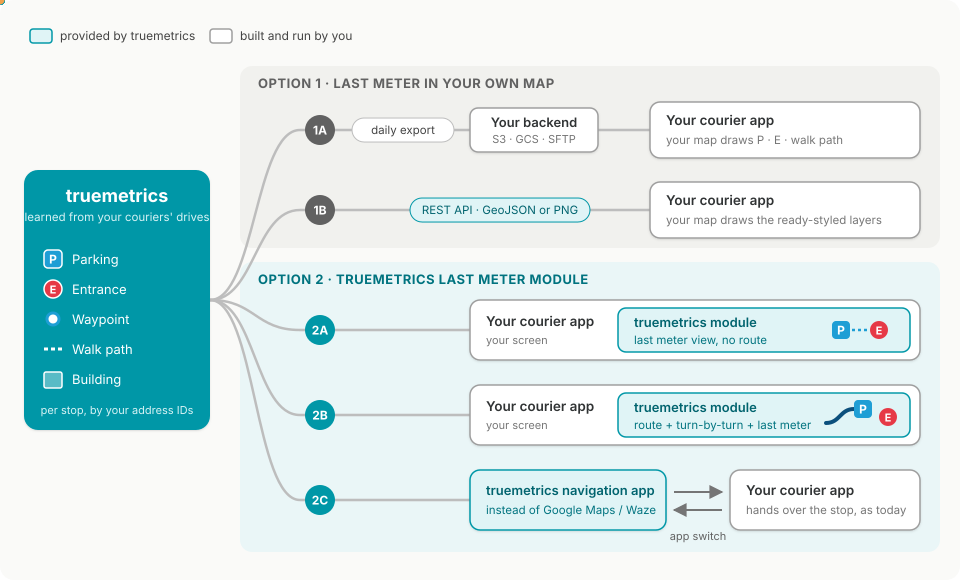

## The main idea

Most navigation apps can only navigate to a generic coordinate. They do not know where couriers
really park, which door they really use, or how they walk from one to the other. That is the **last meter**, and it is where
couriers lose time searching.

truemetrics learns the last meter from your couriers' own deliveries (recorded by the
[truemetrics SDK](/with_agent), keyed by the address IDs you send as [metadata](/metadata)). For
every stop it knows:

- **Waypoint:** where the approach leaves the street. A navigation should route here, not to the address pin.
- **Parking:** where couriers really park, reached from the waypoint.
- **Entrance:** the door that is really used.
- **Walk path:** the way on foot from the parking to the entrance.
- **Building:** the building the entrance belongs to.

## Five ways to use it

You decide how the last meter reaches the courier: as data in your own map (option 1), or with the
truemetrics last meter module inside your app, which brings the map, the routing and the best
practices with it (option 2), or with the truemetrics standalone navigation app instead of Google
Maps or Waze (option 3).

<Frame caption="Where the last meter comes from, and who draws it">
  
</Frame>

<CardGroup cols={2}>
  <Card title="1A · Your map, data from your backend" icon="database" href="/Introduction_to_lastmeter_visualisation#1a-data-from-your-own-backend">
    truemetrics exports parking places, entrances, waypoints and walk paths to your backend. Your
    backend hands them to the courier app with the tour, your map draws them.
  </Card>
  <Card title="1B · Your map, data from the REST API" icon="cloud-arrow-down" href="/Introduction_to_lastmeter_visualisation#1b-data-from-the-truemetrics-rest-api">
    Your app asks the truemetrics REST API per stop and gets ready-styled GeoJSON (or a PNG) for
    your own map.
  </Card>
  <Card title="2 · Module in your app" icon="map-location-dot" href="/navigation_module">
    The truemetrics module shows the stop's last meter and the courier's position inside your app.
    Point-to-point navigation can be off (your navigation stays as it is) or on (turn-by-turn to the
    waypoint, into the parking, arrival at the door): one flag, `routing`.
  </Card>
  <Card title="3 · Standalone navigation app" icon="arrow-right-arrow-left" href="/navigation_app">
    The truemetrics standalone navigation app replaces Google Maps or Waze. Your courier app sends
    the stop as it does to Google Maps and gets the courier back on arrival.
  </Card>
</CardGroup>

## Comparison

<table style={{tableLayout: "fixed", width: "100%"}}>
  <thead>
    <tr>
      <th style={{width: "16%"}}></th>
      <th><strong>1A</strong> own map, own backend</th>
      <th><strong>1B</strong> own map, REST API</th>
      <th><strong>2</strong> module in your app</th>
      <th><strong>3</strong> standalone app</th>
    </tr>
  </thead>
  <tbody>
    <tr>
      <td style={{minWidth: 0}}><strong>Integration effort</strong></td>
      <td style={{minWidth: 0}}>●●●●●</td>
      <td style={{minWidth: 0}}>●●●●○</td>
      <td style={{minWidth: 0}}>●●○○○</td>
      <td style={{minWidth: 0}}>●○○○○</td>
    </tr>
    <tr>
      <td style={{minWidth: 0}}><strong>You build</strong></td>
      <td style={{minWidth: 0}}>Import, delivery to devices, map, styling</td>
      <td style={{minWidth: 0}}>Map, styling, one request per stop</td>
      <td style={{minWidth: 0}}>A place in your screen</td>
      <td style={{minWidth: 0}}>Extras on your Google Maps call</td>
    </tr>
    <tr>
      <td style={{minWidth: 0}}><strong>Best practices</strong></td>
      <td style={{minWidth: 0}}>Yours to implement</td>
      <td style={{minWidth: 0}}>Yours to implement; styling hints included</td>
      <td style={{minWidth: 0}}>Built in; with navigation on, plus routing to the parking</td>
      <td style={{minWidth: 0}}>Built in, plus the way back</td>
    </tr>
    <tr>
      <td style={{minWidth: 0}}><strong>Routing</strong></td>
      <td style={{minWidth: 0}}>Your own</td>
      <td style={{minWidth: 0}}>Your own</td>
      <td style={{minWidth: 0}}>Off: your own On: truemetrics routing*</td>
      <td style={{minWidth: 0}}>truemetrics routing*</td>
    </tr>
    <tr>
      <td style={{minWidth: 0}}><strong>Flexibility</strong></td>
      <td style={{minWidth: 0}}>Full</td>
      <td style={{minWidth: 0}}>Full</td>
      <td style={{minWidth: 0}}>Your screen, truemetrics map</td>
      <td style={{minWidth: 0}}>None</td>
    </tr>
    <tr>
      <td style={{minWidth: 0}}><strong>Control</strong></td>
      <td style={{minWidth: 0}}>●●●●●</td>
      <td style={{minWidth: 0}}>●●●●○</td>
      <td style={{minWidth: 0}}>Off: ●●●○○ On: ●●○○○</td>
      <td style={{minWidth: 0}}>●●○○○</td>
    </tr>
    <tr>
      <td style={{minWidth: 0}}><strong>Platforms</strong></td>
      <td style={{minWidth: 0}}>Any</td>
      <td style={{minWidth: 0}}>Any</td>
      <td style={{minWidth: 0}}>Android</td>
      <td style={{minWidth: 0}}>Android</td>
    </tr>
  </tbody>
</table>

\* Optionally with your own routing server.

**Integration effort**: what it takes to get the last meter in front of the courier. **Flexibility**:
how freely you shape the look and the flow. **Control**: how much of the data and the logic lives in
your own systems: with 1A a full copy of the data is yours and nothing is asked of truemetrics at
delivery time; with 2 (navigation on) and 3 the drive itself runs in truemetrics software, as it runs in Google
Maps today.

### Which one fits

- **You keep your navigation** (Google Maps, HERE, your own) and your own map, with full control
  over data and design: **1A**, if your backend already distributes tours to the devices; **1B**,
  if the app may ask truemetrics directly.
- **You want the last meter shown the way couriers read it best, inside your own app, with little
  work**: **2**. Point-to-point navigation off, next to the navigation you have; on, navigation
  made for the last meter inside your app.
- **Your couriers drive with Google Maps or Waze today**: **3**. The fewest changes, and the
  courier gets routing to the parking, the walk to the entrance and the way back to your app.

Options can be combined: for example 1B in a dispatcher dashboard and 3 on the courier phones.

## What every option needs

<Steps>
  <Step title="truemetrics SDK in your courier app">
    The last meter is learned from your own deliveries: record with the truemetrics SDK and send one
    metadata event per delivery with a stable `address_id`. See [Integrate with an AI agent](/with_agent).
  </Step>
  <Step title="An API key">
    Your truemetrics contact issues it and enables it for the options you use. It scopes all data to
    your account.
  </Step>
  <Step title="Your stop identifiers">
    Each stop is looked up by the `address_id` you send as metadata: typically your address
    identifier or route point identifier.
  </Step>
</Steps>

## Best practices for the last meter

What the truemetrics module and the standalone app (options 2 and 3) do out of the box. With options 1A and 1B, these
are the rules to follow in your own map.

1. **Route to the waypoint, not to the address pin.** The routing target is the waypoint, else the
   parking, else the address. From the waypoint, show the short drive into the parking.
2. **Show the stop before the courier arrives,** with the stop selected or the courier approaching,
   so the parking is chosen while still driving.
3. **Distinct, fixed symbols:** parking blue with a P, entrance red with an E, the walk path dashed,
   the building lightly filled. Use the same symbols on every stop and every screen.
4. **Courier and stop in one frame.** Near the stop, switch to a flat top view that shows the
   courier's position, the parking and the entrance together.
5. **Without routing, do not draw the drive into the parking.** A line from the waypoint to the
   parking reads as a route; show only the parking, the walk path and the entrance.
6. **Fall back without a gap.** No last meter yet for a stop: show the destination and highlight the
   building at it. A failed request is not "no data": ask again (the module retries after 10 and
   30 seconds).
7. **Glanceable, no voice:** one card, the street on one line (cut with "…"), time left and arrival
   time, one button. Couriers look for a second, not longer.
8. **Arrival at the door, not at the pin:** within 30 m of the parking (or the entrance) and slower
   than 15 km/h for 20 seconds. Then lead back to the courier app.
9. **Precise positions only.** An approximate location can be far off; do not draw it as the
   courier's position.
10. **Easy on old devices and the battery.** Draw only when something changes, lower the map
    detail where a device cannot keep up, and test on the devices your couriers use.
