Your courier app starts Google Maps (or Waze) for a stop today. The **truemetrics standalone
navigation app** takes the same call, drives the courier to the waypoint and into the parking,
shows the walk to the entrance, and switches back to your app on arrival.

<Frame caption="The app switch: hand over the stop, drive, back to your app on arrival">
  
</Frame>

## What changes in your app

Three lines on the intent you already send. Google Maps ignores everything beyond the coordinate,
so the same call works whether or not the truemetrics app is installed.

<CodeGroup>
```kotlin Today (Google Maps)
val intent = Intent(Intent.ACTION_VIEW, Uri.parse("google.navigation:q=${stop.lat},${stop.lon}&mode=d"))
startActivity(intent)
```

```kotlin With truemetrics
val intent = Intent(Intent.ACTION_VIEW, Uri.parse("google.navigation:q=${stop.lat},${stop.lon}&mode=d"))
    .setPackage("io.truemetrics.navigation")                 // the truemetrics app, not a chooser
    .putExtra("route", routeJson(tour, nextStop = index))    // the last meter: the stop's IDs
    .putExtra("returnApp", packageName)                      // back to your app on arrival
try {
    startActivity(intent)
} catch (e: ActivityNotFoundException) {
    startActivity(intent.setPackage(null))                   // not installed: Google Maps as before
}
```
</CodeGroup>

`routeJson` builds the tour as in [route](#route), from the IDs you send as metadata:

```kotlin
fun routeJson(tour: List<Stop>, nextStop: Int): String = JSONObject()
    .put("stops", JSONArray(tour.map { stop ->
        JSONObject()
            .put("ID", stop.addressId)               // the address_id you send in the metadata
            .put("line1", stop.street)               // "Gymnasievej 39"
            .put("line2", "Planned Arrival ${stop.plannedArrival}")   // "Planned Arrival 14:22"
    }))
    .put("next_stop", nextStop)
    .toString()
```

### Without native code

Flutter, React Native or a web view can open a plain link instead of building an intent: every
field is also a query parameter of the link, URL-encoded.

```text
truemetrics.navigation://navigate
    ?q=55.654436,12.361784
    &returnApp=com.example.scanner
    &route=<route JSON, URL-encoded>
```

`returnApp` is your own app's package name (its `applicationId`); `com.example.scanner` stands for
it here. The app switches to whichever package is named: another app's brings that app to the
front, and one that is not installed means no switch at all.

<Note>
Shown on several lines for reading; the link itself is one line. Use the `truemetrics.navigation://`
scheme: it opens only the truemetrics app. `google.navigation:` may open Google Maps when both are
installed.
</Note>

<CodeGroup>
```dart Flutter (url_launcher)
final route = Uri.encodeComponent(jsonEncode(routeJson));
// returnApp: your own app's package name (applicationId)
final link = Uri.parse(
  'truemetrics.navigation://navigate?q=$lat,$lng&returnApp=com.example.scanner&route=$route',
);
if (!await launchUrl(link, mode: LaunchMode.externalApplication)) {
  await launchUrl(Uri.parse('google.navigation:q=$lat,$lng&mode=d'));   // not installed
}
```

```javascript React Native
const route = encodeURIComponent(JSON.stringify(routeJson));
// returnApp: your own app's package name (applicationId)
const link = `truemetrics.navigation://navigate?q=${lat},${lng}&returnApp=com.example.scanner&route=${route}`;
Linking.openURL(link).catch(() =>
  Linking.openURL(`google.navigation:q=${lat},${lng}&mode=d`),   // not installed
);
```
</CodeGroup>

## Install the app

truemetrics provides the app (package `io.truemetrics.navigation`) for your devices, for example
through your MDM. On first start it asks for location and, at the first drive, for notifications
(Android 13+). The API key is set up by truemetrics; your courier app needs none.

## The handover

The same link a courier app sends to Google Maps, `google.navigation:q=<lat>,<lng>&mode=d`, with
the fields below as intent extras. Or, as a full link with every field a query parameter:

```text
truemetrics.navigation://navigate?q=55.654436,12.361784&returnApp=com.example.scanner&route=%7B%22stops%22%3A%5B%7B%22ID%22%3A%22%3Caddress_id%3E%22%2C%22line1%22%3A%22Gymnasievej%2039%22%2C%22line2%22%3A%22Planned%20Arrival%2014%3A22%22%7D%2C%7B%22ID%22%3A%22%3Caddress_id%3E%22%2C%22line1%22%3A%22%C3%98sterbyvejen%2033%22%2C%22line2%22%3A%22Planned%20Arrival%2014%3A41%22%7D%5D%2C%22next_stop%22%3A1%7D
```

with `route` decoded:

```json
{"stops":[{"ID":"<address_id>","line1":"Gymnasievej 39","line2":"Planned Arrival 14:22"},{"ID":"<address_id>","line1":"Østerbyvejen 33","line2":"Planned Arrival 14:41"}],"next_stop":1}
```

`q` must be `<lat>,<lng>`, optionally followed by `(label)`. An address instead of coordinates is
rejected (no geocoding).

Every field below except `q` can be an intent extra or a query parameter of the link (URL-encoded); an
extra wins over a parameter of the same name. Extras are strings, except `simulate`
(boolean, or the string `"true"`/`"false"`).

<ParamField path="q" type="string" required>
  The stop: `<lat>,<lng>` in WGS84 degrees, as for Google Maps. Used for routing and the map when
  there is no last meter for the stop.
</ParamField>

<ParamField path="route" type="string (JSON)" required>
  The tour and the stop to drive to. Brings the last meter and the address on the card. See
  [route](#route). Should it be missing or unreadable, the app still drives to `q`, but without a
  last meter.
</ParamField>

<ParamField path="returnApp" type="string">
  Your app's package name, to switch back to on arrival or Back. Brings your app to the front as a
  tap on its icon does.
</ParamField>

<ParamField path="returnUri" type="string">
  A browsable deep link of your app, opened to switch back instead of `returnApp`, for example to
  land on the stop's delivery screen: `scanner://stop/2`. `file:`, `content:`, `intent:` and `android-app:` links are
  ignored.
</ParamField>

### `route`

The whole tour (up to 200 stops) and which of its stops comes next:

```json
{
  "stops": [
    { "ID": "<address_id>", "line1": "Gymnasievej 39", "line2": "Planned Arrival 14:22" },
    { "ID": "<address_id>", "line1": "Østerbyvejen 33", "line2": "Planned Arrival 14:41" },
    { "ID": "<address_id>" }
  ],
  "next_stop": 1
}
```

| Field | Meaning |
| --- | --- |
| `next_stop` | Index in `stops` of the stop to drive to, counted from 0. |
| `ID` | The stop's `address_id`, as sent in the metadata: typically your address identifier or route point identifier. It tells the app where to guide the courier and which last meter to show. A string or a number. |
| `ID_sec` | Optional, usually left out. Only if your system uses a second identifier for the stop (for example a separate parking or route point next to the address), and only if truemetrics asked for it. |
| `line1`, `line2` | Optional: the card's two lines, e.g. street and number, and a second line of your choice such as the planned arrival or postcode and city. Each on one line, cut with "…" when longer. `line2` shows only with `line1`; without `line1` the card shows the `(label)` from `q`, if any. |

The stop at `next_stop` is the one the courier is navigated to; send the whole tour all the same,
the other stops are used as well. Other fields are ignored. A `route` that cannot be read, a
`next_stop` outside the list or a stop with none of these fields counts as no `route`: the app
drives to `q` without a last meter.

## The switch back

With `returnUri` or `returnApp`, the app switches back 10 s after arrival, and its Back button does
the same at any time. Whether arrival switches back by itself is part of the configuration
truemetrics keeps for your key (on by default).

The system Back ends the navigation like the Back button: to `returnUri` or `returnApp`, else to the
app that was in front before. So that your app comes back as the courier left it, its launcher
activity should be `singleTask` or `singleTop`, or use `returnUri` to a screen of your choice.

## What the courier sees

1. **Route overview.** The whole route and a Navigate button, which presses itself after 10 s.
2. **Drive.** Turn-by-turn without voice, to the waypoint, then into the parking. Rerouting with
   real GPS (up to 5 times per drive by default). One card: address, time left, arrival time, Back.
3. **Near the stop.** A flat view with parking, entrance, walk path and building; "Arriving" and the
   street replace the turn banner.
4. **Arrival.** Within 30 m of the parking or entrance and slower than 15 km/h for 20 s, the Back
   button fills up over 10 s, then the app switches back.

The drive goes on with the phone locked or your app in front (a foreground service with a
"Navigation is running" notification; a tap leads back). One handover runs at a time: a new one
replaces the one before, also for the same stop.

## Let an AI agent do it

[Integrate the app switch with an AI agent](/navigation_app_with_agent): a copy-paste prompt that
finds your app's Google Maps call, asks you to confirm the mapping, and implements the handover.

## For testing and demos

Leave these fields out in production. With them the app drives the route by itself, so a stop can be
shown at a desk or in a customer meeting without driving there.

<ParamField path="simulate" type="boolean" default="false">
  `true`: the app drives along the route by itself instead of following GPS, with arrival and the
  switch back as in a real drive. No rerouting.
</ParamField>

<ParamField path="simulationStart" type="string">
  Where the simulated drive starts: `"<lat>,<lng>"`. Left out, at the device's position. A few hundred
  metres before the stop, on the road leading in, shows the approach and the last meter in a minute.
</ParamField>

A simulated handover from a computer, as your app would send it, with your app's package as
`returnApp` (without the `simulate` and `simulationStart` options it drives on GPS):

```bash
adb shell am start -a android.intent.action.VIEW \
  -d "google.navigation:q=55.654436,12.361784&mode=d" \
  -n io.truemetrics.navigation/.ui.navigation.HandoverActivity \
  --es returnApp com.example.scanner \
  --ez simulate true --es simulationStart "55.65624,12.357918"
```

The truemetrics test app ("Scanner (test caller)") hands over stops exactly like this, with a
switch for the simulated drive.
