The truemetrics last meter module (`io.truemetrics:navigation`) is the screen of the
[truemetrics standalone navigation app](/navigation_app) as an Android library: the map, the last
meter, the routing and the best practices, inside your own app. One stop at a time.

It has one switch that matters most, `routing`:

<Frame caption="The module inside your screen: last meter only (2A) and with routing (2B)">
  
</Frame>

| | **2A** `routing = false` (default) | **2B** `routing = true` |
| --- | --- | --- |
| For | Apps that navigate with something else (Google Maps, their own) | Apps that want navigation inside, made for the last meter |
| The map shows | Parking, entrance, walk path, building, and the courier's position as a dot, always in one frame | The route to the waypoint and into the parking, turn-by-turn, then parking, entrance, walk path, building |
| Route, guidance, rerouting | No | Yes (OpenStreetMap, routed by truemetrics) |
| Arrival | No | Within 30 m of the parking or entrance, slower than 15 km/h for 20 s |
| Foreground service | No | While driving on the device's position, so the drive goes on with the phone locked or another app in front |
| Screen kept on | No | While navigating |
| Ends | With Back | On arrival (if configured) or with Back |

Without last-meter data for a stop, the map falls back to the destination and highlights the
building at it.

## Requirements

- Android app in Kotlin or Java, `minSdk` 23 or higher, `compileSdk` 37, Kotlin 2.3 or newer (the
  library brings `kotlin-stdlib` 2.4).
- The screen that shows the module is a `FragmentActivity` (an `AppCompatActivity` is one).
- An API key from truemetrics, enabled for the module.
- Last-meter data: the truemetrics SDK recording in your courier app with `address_id` in the
  metadata (see [Integrate with an AI agent](/with_agent)).

<Note>
Flutter or React Native apps: show the module from a small native Android part
(`NavigationContract`, see [step 4](#4-show-it)), or use the [standalone app](/navigation_app),
which needs no native code at all.
</Note>

## Integration

<Steps>
  <Step title="1. Add the dependency">
    The repository URL and the current version come from your truemetrics contact.

    ```kotlin settings.gradle.kts
    dependencyResolutionManagement {
        repositories {
            google()
            mavenCentral()
            maven { url = uri("<truemetrics Maven repository>") }
        }
    }
    ```

    ```kotlin app/build.gradle.kts
    dependencies {
        implementation("io.truemetrics:navigation:<version>")
    }
    ```

    The library's manifest merges into your app: `INTERNET`, `ACCESS_NETWORK_STATE`,
    `ACCESS_FINE_LOCATION`, `ACCESS_COARSE_LOCATION`, `FOREGROUND_SERVICE`,
    `FOREGROUND_SERVICE_LOCATION`, `POST_NOTIFICATIONS`, its activity and its foreground service.
    Remove none of them.
  </Step>

  <Step title="2. Initialise once">
    In `Application.onCreate`, on the main thread. After Android killed the process it brings an open
    navigation back directly, and only `Application.onCreate` runs before it.

    ```kotlin MyApp.kt
    class MyApp : Application() {
        override fun onCreate() {
            super.onCreate()
            TruemetricsNavigation.init(this, apiKey = BuildConfig.TRUEMETRICS_API_KEY)
        }
    }
    ```
  </Step>

  <Step title="3. Describe the stop">
    One `NavigationRequest` per stop. Only `destination` is required; the IDs bring the last meter.

    ```kotlin
    val request = NavigationRequest(
        destination = LatLon(stop.lat, stop.lon),
        address = stop.street,              // "Gymnasievej 39"
        addressDetail = stop.postcodeCity,  // "2625 Vallensbæk"
        id = stop.addressId,                // as sent in the metadata as address_id
        routing = true,                     // 2B; leave out for 2A
    )
    ```
  </Step>

  <Step title="4. Show it">
    Pick one of three ways.

    <Tabs>
      <Tab title="Inside your layout">
        The fragment in a container of your own screen, between your own bar and buttons.

        ```kotlin
        supportFragmentManager.beginTransaction()
            .add(R.id.navigation_container, TruemetricsNavigationFragment.newInstance(request))
            .commit()
        ```

        `R.id.navigation_container` is a `FrameLayout` or `FragmentContainerView` of at least about
        400 dp height. The full example below shows the rest.
      </Tab>
      <Tab title="Compose">
        From `androidx.fragment:fragment-compose`, in an activity that is a `FragmentActivity`:

        ```kotlin
        AndroidFragment<TruemetricsNavigationFragment>(
            modifier = Modifier.fillMaxWidth().height(480.dp),
            arguments = TruemetricsNavigationFragment.arguments(request),
        )
        ```
      </Tab>
      <Tab title="A screen of its own">
        The module's own activity, full screen, returning how it ended:

        ```kotlin
        private val navigate = registerForActivityResult(NavigationContract()) { result ->
            when (result) {
                NavigationResult.Arrived -> markArrived()
                NavigationResult.Ended -> Unit
            }
        }

        navigate.launch(request)
        ```

        The card at the bottom then shows the address, time left, arrival time and a "Back" button.
      </Tab>
    </Tabs>
  </Step>

  <Step title="5. Hear the end">
    The navigation ends on arrival (`NavigationResult.Arrived`), or with Back, ✕ or the system Back
    (`NavigationResult.Ended`). Take the fragment away then.

    Either implement `TruemetricsNavigationFragment.Host` on the activity (or the parent fragment):
    it hears the end at once, also while your screen is out of sight, for example with the phone
    locked. Or listen for the fragment result, delivered when your screen is started:

    ```kotlin
    supportFragmentManager.setFragmentResultListener(TruemetricsNavigationFragment.RESULT_KEY, this) { _, bundle ->
        val result = TruemetricsNavigationFragment.result(bundle)
        closeNavigation()
    }
    ```
  </Step>

  <Step title="6. Declare the screen">
    The activity that holds the module keeps the map through dark-mode switches and rotation:

    ```xml AndroidManifest.xml
    <activity
        android:name=".StopActivity"
        android:configChanges="uiMode"
        android:screenOrientation="portrait" />
    ```
  </Step>
</Steps>

## Full example

A stop screen of a courier app: its own bar and "Delivered" button, the module in between. This is
how truemetrics' own test app embeds it.

```kotlin StopActivity.kt
class StopActivity : AppCompatActivity(), TruemetricsNavigationFragment.Host {

    override fun onCreate(savedInstanceState: Bundle?) {
        super.onCreate(savedInstanceState)
        setContentView(R.layout.activity_stop)   // bar, R.id.navigation_container, "Delivered" button

        // Android restores the fragment itself after a configuration change or process death
        if (savedInstanceState == null) {
            val stop = intent.getParcelableExtra<Stop>("stop")!!
            show(
                NavigationRequest(
                    destination = LatLon(stop.lat, stop.lon),
                    address = stop.street,
                    addressDetail = stop.postcodeCity,
                    id = stop.addressId,
                    routing = stop.routeInApp,       // false: 2A, true: 2B
                    // The stop's details and the way out are this screen's own, around the map
                    showCard = false,
                    backLabel = null,
                    endOnArrival = true,
                ),
            )
        }
    }

    private fun show(request: NavigationRequest) {
        // One navigation per activity: the old one goes first, with commitNow
        close()
        supportFragmentManager.beginTransaction()
            .add(R.id.navigation_container, TruemetricsNavigationFragment.newInstance(request))
            .commit()
    }

    private fun close() {
        supportFragmentManager.findFragmentById(R.id.navigation_container)?.let {
            // Also when the navigation ended out of sight, with this screen's state already saved
            supportFragmentManager.beginTransaction().remove(it).commitNowAllowingStateLoss()
        }
    }

    // Arrived, or Back inside the map: at once, also with the phone locked
    override fun onNavigationFinished(result: NavigationResult) {
        close()
        if (result == NavigationResult.Arrived) showDeliveryForm() else finish()
    }
}
```

## Parameters

### `TruemetricsNavigation.init`

<ParamField path="context" type="Context" required>
  Your application context.
</ParamField>

<ParamField path="apiKey" type="String" required>
  The truemetrics API key: last meter, routing, configuration. Keep it in your build config or
  secrets, never in source. Call `init` again to switch the key; screens opened afterwards use the
  new one.
</ParamField>

### `NavigationRequest`

<ParamField path="destination" type="LatLon" required>
  The stop in WGS84 degrees, latitude first: the coordinate you hand to Google Maps today. Used for
  routing and the map when there is no last meter for the stop. An invalid position throws.
</ParamField>

<ParamField path="id" type="String">
  The stop's `address_id`, as sent in the metadata: typically your address identifier or route point
  identifier. It tells the module where to guide the courier and which last meter to show. Without
  it the map shows the destination only.
</ParamField>

<ParamField path="idSecondary" type="String">
  Optional, usually left out. Only if your system uses a second identifier for the stop (for
  example a separate parking or route point next to the address), and only if truemetrics asked
  for it.
</ParamField>

<ParamField path="routing" type="Boolean" default="false">
  `false` (2A): the last meter and the courier's position, no route. `true` (2B): route to the
  waypoint (else the parking, else the destination), turn-by-turn guidance, rerouting, arrival.
</ParamField>

<ParamField path="address" type="String">
  The card's first line: street and number, or a place name. One line, a longer one is cut with "…".
</ParamField>

<ParamField path="addressDetail" type="String">
  The card's second line: postcode and city.
</ParamField>

<ParamField path="showCard" type="Boolean" default="true">
  The card at the bottom (address, time left, arrival time, one button) and the ✕. Set `false` when
  your own screen shows the stop and the way out around the map; with routing the drive then starts
  by itself after the route overview.
</ParamField>

<ParamField path="backLabel" type="String" default='"Back"'>
  The text of the card's Back button. `null` for none; an ✕ ends the navigation then.
</ParamField>

<ParamField path="endOnArrival" type="Boolean">
  Whether the navigation ends by itself a few seconds after arrival (`NavigationResult.Arrived`), or
  stays on the map until the courier leaves. Left out: it ends when there is a Back button and the
  configuration for your key allows it. Without the card, pass `true`.
</ParamField>

### Results

| `NavigationResult` | When |
| --- | --- |
| `Arrived` | At the stop: after the arrival countdown, or the courier left the arrival card. |
| `Ended` | Before arriving: Back, ✕ or the system Back. |

## Good to know

- **One module per activity.** For the next stop, remove the old fragment with `commitNow()` first,
  then add the new one. A `replace` builds the new map while the old one still lives.
- **Permissions.** The module asks for location itself, and for notifications at the first drive
  (Android 13+). Without location it says so on the map and offers the fix.
- **Back.** The system Back ends the navigation (you hear it as the result); after that, Back is
  yours again.
- **Theme.** The map puts its own theme on the activity while it is created; the module puts your
  manifest theme back right away. If you set your theme in code, set it again after adding the
  fragment.
- **Approximate location.** With approximate location only, the courier's dot is not shown and an
  arrival cannot be noticed; the module says so.
- **Configuration from truemetrics.** Reroute limits, arrival behaviour and similar settings come
  per API key from truemetrics. A drive keeps the configuration it started with.
- **Battery.** The map draws only when something changes, the screen stays on only while
  navigating, and the foreground service runs only during a drive on the device's position.
- **Your own MapLibre.** If your app uses MapLibre itself, tell your truemetrics contact: the
  module sets MapLibre's process-wide settings at the first `init`.

## Let an AI agent do it

[Integrate the module with an AI agent](/navigation_module_with_agent): a copy-paste prompt that
analyses your app, asks you to confirm each step, and implements the integration above.

## For testing and demos

Leave these out in production. With them a drive runs by itself, so a stop can be shown at a desk
or in a customer meeting without driving there.

<ParamField path="simulate" type="Boolean" default="false">
  `NavigationRequest`, with `routing = true`: drive along the route by itself instead of following
  the device location, with arrival as in a real drive. No rerouting.
</ParamField>

<ParamField path="simulationStart" type="LatLon">
  `NavigationRequest`: where the simulated drive starts. Left out, at the device location. A few
  hundred metres before the stop, on the road leading in, shows the approach and the last meter in
  a minute.
</ParamField>

<ParamField path="simulateByDefault" type="Boolean" default="false">
  `TruemetricsNavigation.init`: whether a drive from the module's own address search is simulated
  until the courier flips the switch. Not used for requests from your app.
</ParamField>

```kotlin
NavigationRequest(
    destination = LatLon(55.654436, 12.361784),
    id = "9005000000042962227",
    idSecondary = "9005000000042962733",
    routing = true,
    simulate = true,
    simulationStart = LatLon(55.65624, 12.357918),
)
```
